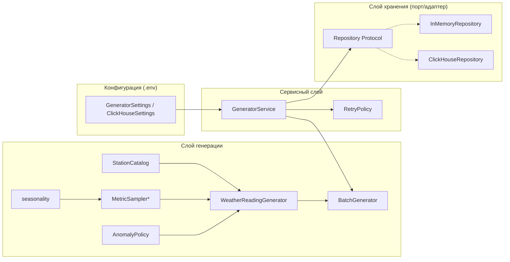

<p align="center">
  <h1 align="center">⚡ RealTime-AnalyticsPlatform</h1>
  <p align="center">Production-ready платформа для end-to-end потоковой аналитики</p>
  <p align="center">
    <em>Модуль генерации данных — первый компонент платформы</em>
  </p>
  <p align="center">
    
    
    
    
    
  </p>
</p>

---

## 📖 О платформе

**RealTime-AnalyticsPlatform** — production-ready платформа для end-to-end потоковой
аналитики: сбор → хранение → анализ → визуализация данных в реальном времени.

Данный репозиторий содержит **полный пайплайн платформы**: генератор данных
(генерирует **реалистичный поток показаний метеостанций** и пишет его **батчами**),
хранилище **ClickHouse**, BI-визуализацию в **Superset** и веб-дашборд платформы (**UI**).
Всё поднимается через `docker-compose` (см. [Запуск полной платформы](#-запуск-полной-платформы-docker)).

### ✨ Возможности модуля генерации

- 🎯 **Реалистичные показания** — температура, влажность, давление, скорость и
  направление ветра, категория погоды.
- 🌗 **Сезонность** — суточный (днём теплее) и годовой (летом теплее) циклы,
  климат конкретного города и случайный шум.
- ⚡ **Аномалии** — редкие выбросы (тепловая волна, скачок холода, падение давления,
  порыв ветра) помечаются флагом `is_anomaly` — «дрожжи» для последующего анализа.
- 🚀 **Батчевая запись** — пачками, а не по одной строке.
- 🔁 **Устойчивость к отказам** — retry с экспоненциальным backoff и джиттером.
- 🛑 **Graceful shutdown** — корректно завершается по `SIGINT`/`SIGTERM`.
- 🧪 **Детерминизм** — при одинаковом `seed` выдаёт одинаковые данные.

---

## 🏗 Архитектура

Проект построен по принципам **чистой архитектуры**: ядро домена не зависит ни от
конкретной БД, ни от способа генерации.



### Слои

| Слой | Файл | Ответственность |
|------|------|-----------------|
| 🧩 Домен | `models.py` | `Station`, `WeatherReading` — чистые модели без знания о БД |
| ⚙️ Генерация | `generation/` | сезонность, самплеры метрик (Strategy), аномалии, справочник |
| 🔄 Сервис | `service/generator.py` | цикл «батч → запись», retry, graceful shutdown |
| 💾 Хранение | `repository/` | порт `Repository` + реализации `InMemory` / `ClickHouse` |
| ⚙️ Конфигурация | `config.py` | настройки из env (префиксы `GENERATOR_*`, `CLICKHOUSE_*`) |

### Применяемые принципы

- **Strategy** — каждая метрика (`TemperatureSampler`, `HumiditySampler`, …) — отдельная
  стратегия с единым контрактом `sample(ctx, rng)`. Новая метрика = один новый класс.
- **Ports & Adapters (DIP)** — сервис зависит от абстракции `Repository`, а не от БД;
  `InMemoryRepository` позволяет запускать генератор без ClickHouse.
- **Инъекция зависимостей** — всё собирается в `cli.py` (композиционный корень).
- **Чистые функции** — сезонность зависит только от момента времени, что легко
  тестировать на фиксированных датах.

---

## 🚀 Быстрый старт

Требуется [uv](https://docs.astral.sh/uv/).

```bash
# 1. Установить зависимости
uv sync

# 2. Быстрая проверка: один батч в память (без БД)
uv run weather-generator --once

# 3. Непрерывная генерация в память (Ctrl+C — graceful shutdown)
uv run weather-generator

# 4. Запись в ClickHouse
cp .env.example .env   # при необходимости отредактировать
uv run weather-generator --repository clickhouse

# 5. Тесты, линт, типы
uv run pytest
uv run ruff check .
uv run mypy src
```

---

## 🐳 Запуск полной платформы (Docker)

Полная платформа (ClickHouse + генератор + Superset + UI-дашборд) запускается одним
`docker-compose`. Команды ниже используют standalone-бинарник `docker-compose`.

> ⚠️ **Корпоративная сеть.** Внутри контура `docker.io` заблокирован, поэтому образ
> ClickHouse тянется через корпоративный прокси-реестр Artifactory
> `docker-proxy.artifactory.tcsbank.ru`. Вне корпоративной сети замените `FROM` в
> `superset/Dockerfile` на `apache/superset:latest` и уберите прокси-префикс в
> `docker-compose.yml`, если нужно.

### 1. Подготовка и скачивание образов

```bash
# (опц.) скачать внешние образы через прокси-реестр
docker-compose pull

# собрать локальные образы (generator, superset, ui)
docker-compose build
```

### 2. Старт всех сервисов

```bash
docker-compose up -d
docker-compose ps          # дождаться healthy для clickhouse и superset
```

Сервисы:

| Сервис | URL / порт | Назначение |
|--------|-----------|------------|
| **ClickHouse** | `localhost:8123` (HTTP), `9000` (TCP) | хранилище данных |
| **generator** | `localhost:9100` | control-endpoint генератора |
| **Superset** | `localhost:8088` | BI-визуализация |
| **UI** | `localhost:8000` | веб-дашборд платформы (статус/логи/данные) |

### 3. Первый запуск Superset

Entrypoint контейнера `superset` автоматически выполняет при первом старте:
`db upgrade`, создание администратора, `superset init` (права) и подключение к
ClickHouse (база `ClickHouse`). Логин по умолчанию — **`admin` / `admin`**.

### 4. Генератор данных

Генератор сам создаёт схему и справочник станций, делает **бэкфилл** с
`2025-01-01` до текущего момента (возобновляясь с последнего таймстемпа, без дублей),
затем переходит в **realtime** (1 запись/сек).

```bash
# посмотреть лог генератора (фаза/прогресс)
docker-compose logs -f generator

# состояние генерации (фаза, текущий таймстемп, прогресс)
curl localhost:9100/rate

# остановить генератор
curl -X POST localhost:9100/stop
```

> Сброс данных и повторный бэкфилл: `docker exec clickhouse clickhouse-client
> --query "TRUNCATE TABLE weather.readings"` и затем перезапустить генератор
> (`docker-compose restart generator`).

### 5. Дашборд в Superset

Чарты и дашборд создаются скриптами (см. `superset/`). Выполнить один раз:

```bash
docker cp superset/provision_dashboard.py superset:/app/provision_dashboard.py
docker exec superset python3 /app/provision_dashboard.py   # датасеты + 13 чартов
docker cp superset/build_dashboard.py superset:/app/build_dashboard.py
docker exec superset python3 /app/build_dashboard.py       # сборка раскладки
```

После этого дашборд **«Погода — пайплайн данных»** доступен в Superset
(`localhost:8088`, меню Dashboards).

> Полезные скрипты: `superset/verify_all.py` — проверка выполнения запросов чартов,
> `superset/fix_charts.py` — точечные правки параметров KPI/gauge.

---

## ⚙️ Конфигурация

Настройки читаются из переменных окружения и файла `.env` (см. [`.env.example`](.env.example)).

### Генератор (`GENERATOR_*`)

Настройки генератора читаются из env (префикс `GENERATOR_*`). Модель генерации —
двухфазная: **бэкфилл** (историческое окно от `backfill_start` до текущего момента)
и **realtime** (1 запись в секунду после догона текущего времени).

| Переменная | По умолчанию | Назначение |
|-----------|--------------|------------|
| `GENERATOR_BATCH_SIZE` | `1000` | записей в одном батче вставки (бэкфилл) |
| `GENERATOR_BACKFILL_START` | `2025-01-01T00:00:00` | начало бэкфилла (ISO) |
| `GENERATOR_BACKFILL_STEP_SECONDS` | `60.0` | шаг таймстемпа между записями при бэкфилле |
| `GENERATOR_REALTIME_STEP_SECONDS` | `1.0` | шаг в realtime-фазе (1 запись/сек) |
| `GENERATOR_SEED` | `42` | воспроизводимость генерации |
| `GENERATOR_ANOMALY_PROBABILITY` | `0.02` | вероятность аномалии на запись |
| `GENERATOR_ANOMALY_STRENGTH` | `3.0` | сила аномалии |
| `GENERATOR_CITIES` | список | города станций через запятую |
| `GENERATOR_CONTROL_HOST` | `0.0.0.0` | адрес control-endpoint |
| `GENERATOR_CONTROL_PORT` | `0` | порт control-endpoint (0 = выключен) |
| `GENERATOR_RETRY_*` | — | параметры backoff при отказах БД |

### ClickHouse (`CLICKHOUSE_*`)

| Переменная | По умолчанию | Назначение |
|-----------|--------------|------------|
| `CLICKHOUSE_HOST` | `localhost` | хост БД |
| `CLICKHOUSE_PORT` | `8123` | HTTP-порт |
| `CLICKHOUSE_DATABASE` | `weather` | имя БД |
| `CLICKHOUSE_USER` | `default` | пользователь |
| `CLICKHOUSE_PASSWORD` | — | пароль |

---

## 📊 Данные

**`stations`** (справочник/размерность): `station_id`, `name`, `city`,
`latitude`, `longitude`, `altitude`.

**`readings`** (события):

| Поле | Тип | Роль |
|------|-----|------|
| `station_id` | int | связь со справочником |
| `timestamp` | datetime | момент измерения (UTC) |
| `temperature_c` | float | метрика |
| `humidity_pct` | float | метрика |
| `pressure_hpa` | float | метрика |
| `wind_speed_ms` | float | метрика |
| `wind_direction_deg` | float | размерность |
| `weather_type` | enum | размерность: `clear/cloudy/fog/rain/snow/storm` |
| `is_anomaly` | bool | флаг выброса для анализа |

---

## 🧱 Структура проекта

```
src/generator/
├── cli.py                 # CLI, обработка сигналов, композиционный корень
├── config.py              # настройки из env
├── models.py              # доменные модели: Station, WeatherReading
├── retry.py               # RetryPolicy: экспоненциальный backoff + джиттер
├── generation/            # слой генерации данных
│   ├── seasonality.py     # суточный и годовой циклы (чистые функции)
│   ├── metrics.py         # самплеры метрик (Strategy) + ClimateProfile
│   ├── anomalies.py       # AnomalyPolicy: редкие выбросы
│   ├── catalog.py         # справочник станций и климатические профили городов
│   └── weather.py         # WeatherReadingGenerator + BatchGenerator
├── repository/            # слой хранения
│   ├── base.py            # порт Repository (Protocol)
│   ├── in_memory.py       # in-memory реализация (тесты / запуск без БД)
│   └── clickhouse.py      # ClickHouse-реализация (batch insert)
└── service/
    └── generator.py       # GeneratorService: основной цикл
```

---

## 📚 Модули платформы

RealTime-AnalyticsPlatform строится по модулям. Этот репозиторий объединяет основные
компоненты пайплайна: **генератор данных**, **ClickHouse**, **Superset** и **UI-дашборд**,
поднимаемые через `docker-compose`. Дальнейшие воркшопы (Jupyter-анализ, расширенные
витрины/материализованные представления, продвинутые дашборды) строятся поверх него.

---

<p align="center">
  <sub>Сделано для серии воркшопов · Замечания и предложения приветствуются</sub>
</p>