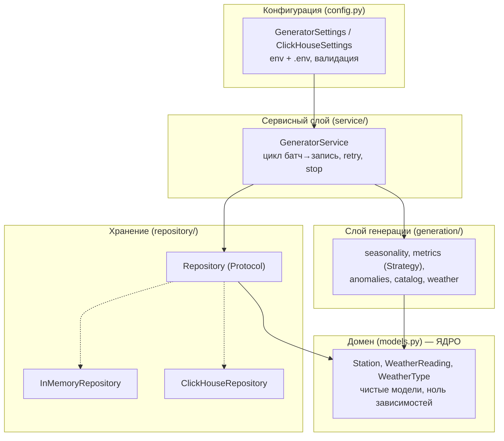
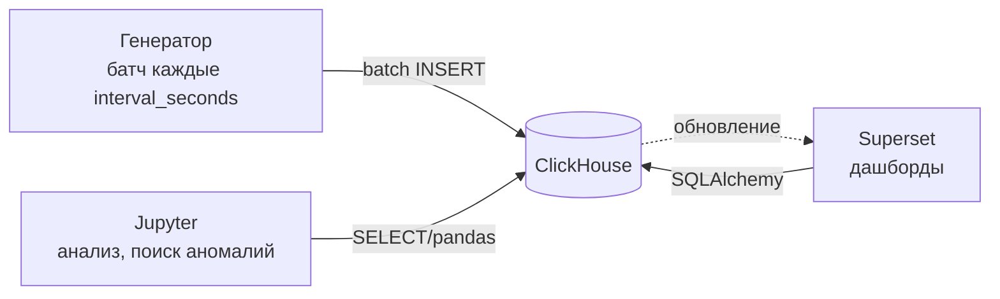

# Инструкция: проект генератора данных (RealTime-AnalyticsPlatform)

> Полный разбор для проведения занятия: что за проект, из чего состоит,
> как работает каждый файл, что показывают демо, зачем Dockerfile, как запускать.

---

## 0. Что это за проект (30 секунд)

**Генератор данных метеостанций** — первый модуль платформы **RealTime-AnalyticsPlatform**
(production-ready платформа для end-to-end потоковой аналитики).

Производит **реалистичный поток показаний** (температура, влажность, давление, ветер, погода)
и пишет их **батчами в ClickHouse**. Дальше эти данные анализируются в Jupyter и
визуализируются в Superset (следующие модули).

Ключевые свойства:
- **Детерминизм** — одинаковый `seed` → одинаковые данные.
- **Реализм** — суточный и годовой циклы, климат города, шум.
- **Аномалии** — редкие выбросы с флагом `is_anomaly` (их потом ищут студенты).
- **Устойчивость** — retry, graceful shutdown, ожидание ClickHouse.
- **Чистая архитектура** — домен не зависит от БД.

---

## 1. Архитектура (карта слоёв)



**Правило:** зависимости направлены «вниз» — к чистому ядру (домену). Всё собирается в `cli.py` (композиционный корень).

---

## 2. Исходные файлы — что и зачем

### 2.1. `models.py` — домен (ядро)
Чистые модели без знания о БД:
- `WeatherType` — перечисление погоды (`StrEnum`: значения = строки).
- `Station` — станция (справочник).
- `WeatherReading` — показание (событие), поля: `station_id`, `timestamp`, метрики, `weather_type`, `is_anomaly`.

`@dataclass(frozen=True, slots=True)` — неизменяемость + экономия памяти.

### 2.2. `config.py` — конфигурация
Читает настройки из переменных окружения и `.env` (pydantic-settings).
- `GeneratorSettings` (префикс `GENERATOR_*`): `batch_size`, `interval_seconds`, `seed`, `anomaly_probability`, …
- `ClickHouseSettings` (префикс `CLICKHOUSE_*`): `host`, `port`, `database`, `user`, `password`.
- `Field(ge=…, le=…)` — валидация при загрузке.
- `@lru_cache get_settings()` — синглтон (настройки читаются один раз).
- `@property city_list` — строка городов → список.

### 2.3. `generation/seasonality.py` — сезонность
Чистые функции времени:
- `diurnal_factor(at)` — суточный цикл (пик ~15:00, минимум ~03:00).
- `annual_factor(at)` — годовой цикл (пик ~15 июля, минимум ~январь).
Возвращают множитель `[-1, 1]`.

### 2.4. `generation/metrics.py` — самплеры метрик (Strategy)
- `ClimateProfile` — климатический «фон» города.
- `ReadingContext` — контекст показания (время + температура для корреляций).
- `MetricSampler` (ABC) — контракт `sample(ctx, rng) -> float`.
- Реализации: `TemperatureSampler`, `HumiditySampler`, `PressureSampler`, `WindSpeedSampler`, `WindDirectionSampler`.
  - Температура: климат + сезонность + гауссов шум.
  - Влажность: обратная корреляция с температурой.
  - Ветер: логнормальное распределение (чаще тихо, реже порывы).

### 2.5. `generation/anomalies.py` — аномалии
- `AnomalyKind` (`StrEnum`): `HEAT_WAVE`, `COLD_SNAP`, `PRESSURE_DROP`, `WIND_GUST`.
- `AnomalyPolicy.decide()` — с вероятностью решает, выпадет ли аномалия и какая. Использует сидированный `rng`.

### 2.6. `generation/catalog.py` — справочник станций
- `StationCatalog` строит станции из списка городов.
- `_TEMPLATES` — климатические профили городов; `_GENERIC` — запасной профиль для неизвестных городов.

### 2.7. `generation/weather.py` — генератор показаний
- `_WeatherTypePicker` — эвристика выбора погоды.
- `WeatherReadingGenerator` — фасад: собирает самплеры + аномалии в одно показание.
- `BatchGenerator` — чередует станции и выдаёт пачки показаний (`generate_batch`).

### 2.8. `retry.py` — устойчивость к отказам
- `RetryPolicy.execute(fn)` — повторяет вызов с **экспоненциальным backoff + джиттером**.
- `RetryError` — когда попытки исчерпаны.
- `sleep` инъектируется (тестируемость).

### 2.9. `repository/base.py` — порт хранения
- `Repository` (Protocol) — контракт: `ensure_schema`, `upsert_stations`, `insert_readings`.
- Сервис зависит от абстракции, а не от БД (DIP).

### 2.10. `repository/in_memory.py` — in-memory реализация
- Хранит данные в списках. Нужна для тестов и запуска без ClickHouse.

### 2.11. `repository/clickhouse.py` — ClickHouse-реализация
- **Ленивое соединение** (клиент создаётся при первом обращении).
- `ensure_schema` — создаёт БД `weather` + таблицы `stations`, `readings` (идемпотентно, `IF NOT EXISTS`).
- **Батчевая вставка** — один `INSERT` на пачку (не построчно).
- Соединение **не привязано к базе** (чтобы `CREATE DATABASE` работал для новой БД).

### 2.12. `service/generator.py` — сервис
- `GeneratorService.run()` — непрерывный цикл «батч → запись → пауза» до `stop_event`.
- `run_once()` — схема + станции + один батч.
- `build_service()` — собирает сервис с `RetryPolicy`.
- `clock`/`sleep` инъектируются (тестируемость).

### 2.13. `cli.py` — точка входа + композиционный корень
- `argparse`: `--repository in-memory|clickhouse`, `--once`.
- Собирает всё: настройки → каталог → anomaly_policy → batch_generator → репозиторий → сервис.
- Обработчики `SIGINT`/`SIGTERM` → `stop_event` (graceful shutdown).

---

## 3. Демо-сценарии (`demos/`)

| Файл | Сценарий | Что показывает | Запуск |
|------|----------|----------------|--------|
| `01_in_memory.py` | Генерация в память | сами показания на разных датах 2026, сезонность | `uv run python demos/01_in_memory.py` |
| `02_to_clickhouse.py` | Запись в ClickHouse | путь записи: схема + станции + батчи, проверка данных | `uv run python demos/02_to_clickhouse.py` |
| `03_wait_for_clickhouse.py` | Ожидание ClickHouse | генератор ждёт готовности CH (опрос + таймаут) | `uv run python demos/03_wait_for_clickhouse.py --timeout 60` |
| `04_continuous.py` | Непрерывная генерация | непрерывный режим + graceful shutdown (Ctrl+C) | `uv run python demos/04_continuous.py --repository clickhouse` |
| `_ch.py` | (хелпер) | утилиты ClickHouse: ping, авторизация, клиент | — |

**Порядок и цель:**
1. `01` — понять, ЧТО производит генератор (без инфраструктуры).
2. `02` — увидеть, КАК данные попадают в ClickHouse.
3. `03` — обсудить «должен ли генератор ждать ClickHouse» — показать ожидание.
4. `04` — показать «боевой» непрерывный режим и корректную остановку.

---

## 4. Dockerfile и docker-compose

### 4.1. `Dockerfile` (образ генератора)

| Строка | Для чего |
|--------|----------|
| `FROM …python:3.12-slim` | база с Python (через корп. прокси-реестр) |
| `WORKDIR /app` | рабочая папка в контейнере |
| `ENV PYTHONPATH=/app/src` | чтобы пакет `generator` был импортируемым |
| `ENV PYTHONUNBUFFERED=1` | логи в реальном времени |
| `COPY pyproject.toml ./` + `COPY src ./src` | положить код в образ |
| `RUN pip install …` | установить зависимости (clickhouse-connect, pydantic-settings) |
| `CMD ["python","-m","generator","--repository","clickhouse"]` | команда запуска |

### 4.2. `docker-compose.yml` (весь сервис «в сборе»)
- `clickhouse` — с healthcheck по `/ping`;
- `generator` — `depends_on: clickhouse: condition: service_healthy` → стартует **только когда ClickHouse здоров**.

```bash
docker compose up --build
```
> На этой машине compose-плагин не установлен — стек поднимается вручную (`docker network create` + `docker run` ×2).

### 4.3. `.dockerignore`
Исключает из сборки лишнее: `.venv`, `docs`, тесты, кэши, `.env`.

---

## 5. Как запустить (порядок)

```bash
# 1. Установить зависимости
uv sync

# 2. Настроить .env (пароль ClickHouse)
cp .env.example .env        # вписать CLICKHOUSE_PASSWORD=clickhouse

# 3. Поднять ClickHouse
docker start clickhouse
# или впервые:
docker run -d -p 8123:8123 -p 9000:9000 --name clickhouse \
  -e CLICKHOUSE_USER=default -e CLICKHOUSE_PASSWORD=clickhouse \
  docker-proxy.artifactory.tcsbank.ru/clickhouse/clickhouse-server
curl http://localhost:8123/ping    # → Ok.

# 4. Демо по порядку
uv run python demos/01_in_memory.py
uv run python demos/02_to_clickhouse.py
uv run python demos/03_wait_for_clickhouse.py --timeout 60
uv run python demos/04_continuous.py --repository clickhouse

# 5. Проверка качества
uv run pytest
uv run ruff check .
uv run mypy src
```

> Все команды — **из корня проекта** `/Users/da.goncharuk/PycharmProjects/Generator`. Сценарии 2–4 требуют запущенного ClickHouse.

---

## 6. Как вся система работает целиком (поток данных)



1. **Генератор** пишет батчами в ClickHouse (таблицы `stations` + `readings`).
2. **ClickHouse** — OLAP-хранилище: быстро хранит и агрегирует.
3. **Jupyter** — аналитик/студент: подключается, ищет сезонность и аномалии.
4. **Superset** — живые дашборды поверх ClickHouse.

Модель «реального времени» — **микро-батчи** (интервал `interval_seconds`): near-real-time,
не классический стриминг (Kafka — следующий модуль).

---

## 7. Чек-лист перед занятием
- [ ] `uv sync` выполнен
- [ ] `.env` есть и там `CLICKHOUSE_PASSWORD=clickhouse`
- [ ] ClickHouse запущен (`docker ps` → `clickhouse` Up; `curl :8123/ping` → Ok)
- [ ] Терминал в корне проекта
- [ ] Демо 1–4 прогнаны заранее