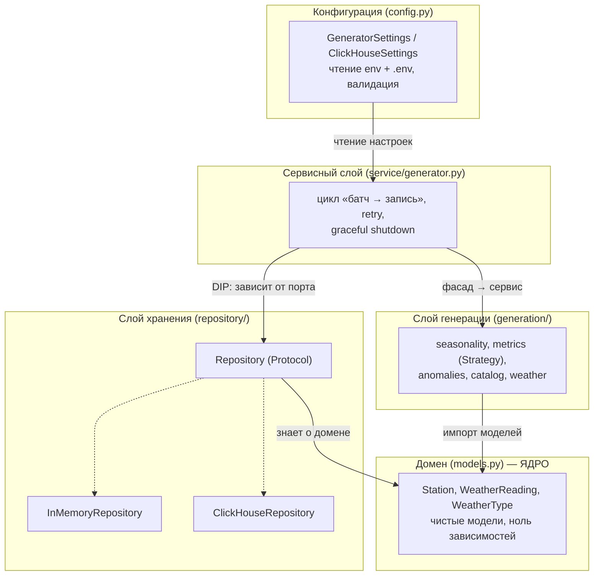
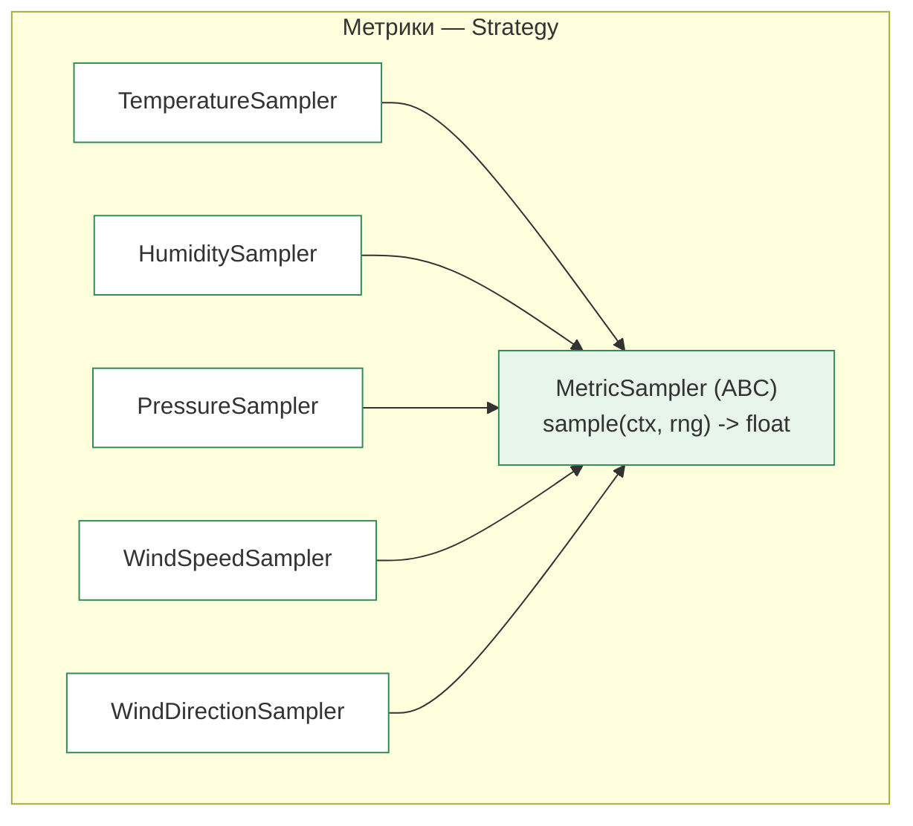
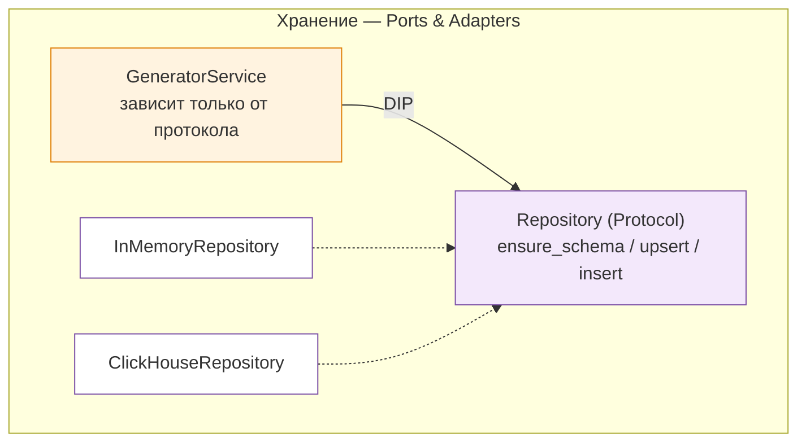
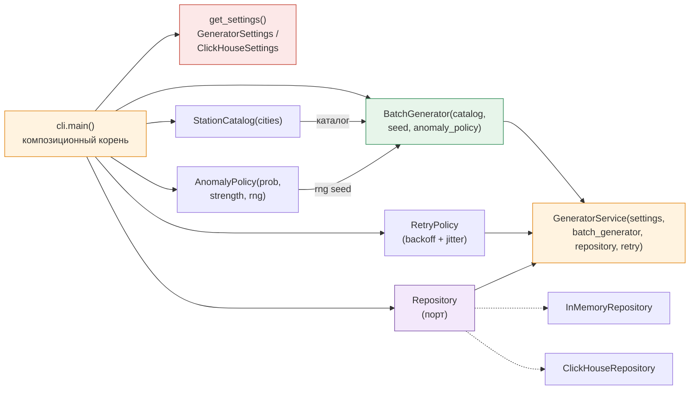
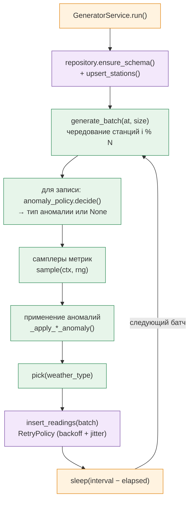

# ⚡ RealTime-AnalyticsPlatform

## Архитектура модуля генерации данных

**Production-ready платформа для end-to-end потоковой аналитики** · диаграммы архитектуры

---

# Часть A. Архитектура

# Архитектура RealTime-AnalyticsPlatform · модуль генерации данных

> Полный разбор архитектуры проекта с обоснованием каждого решения —
> «почему так, а не иначе». Написано как учебный материал для студентов.

---

## 0. TL;DR — архитектура в одном абзаце

Проект — это **генератор реалистичного потока данных метеостанций**, построенный по
принципам **чистой архитектуры**. В центре — **чистый домен** (модели без знания о БД),
вокруг — слои **генерации** и **хранения**, которые зависят только от домена и не знают
друг о друге. Всё **собирается в одном месте** (композиционный корень в `cli.py`) через
**инъекцию зависимостей**, генерация **детерминирована** за счёт сидированного `rng`,
а запись в БД **устойчива к отказам** через `RetryPolicy` с экспоненциальным backoff.

---

## 1. Цели и ограничения (то, что определяло выбор)

Любая архитектура — это набор компромиссов под конкретные цели. Сформулируем их явно:

1. **Обучаемость** — проект разбирается на воркшопах, поэтому решения должны быть
   наглядными и «один приём — один смысл».
2. **Тестируемость** — генератор и сервис должны проверяться без реальной БД.
3. **Воспроизводимость** — при одинаковом `seed` — одинаковые данные (это важно для
   анализа и для студентов, чтобы все видели один и тот же датасет).
4. **Расширяемость** — добавление новой метрики или нового хранилища не должно ломать
   существующий код.
5. **Простота** — без лишней абстракции «на вырост»; ровно столько слоёв, сколько нужно.

> Почему такие цели: проект — учебный E2E (генератор → ClickHouse → Jupyter/Superset).
> Главный риск — что студент не сможет понять, как всё связано, или что код нельзя
> проверить без поднятия инфраструктуры. Поэтому тестируемость и наглядность первичны.

---

## 2. Слоистая архитектура и направление зависимостей



### Слои сверху вниз

| Слой | Файлы | Ответственность |
|------|-------|-----------------|
| **Конфигурация** | `config.py` | чтение настроек из env / `.env`, валидация |
| **Сервис** | `service/generator.py` | основной цикл, retry, graceful shutdown |
| **Генерация** | `generation/` | сезонность, самплеры, аномалии, справочник |
| **Хранение** | `repository/` | порт + адаптеры (InMemory, ClickHouse) |
| **Домен (ядро)** | `models.py` | чистые модели `Station`, `WeatherReading` |

### Правило зависимостей
**Зависимости направлены вниз — к чистому ядру.** Домен не импортирует ничего, кроме
стандартной библиотеки. Генерация и хранение зависят от домена, но **не зависят друг
от друга**. Конфигурация читается сверху и «впрыскивается» вниз.

### Почему так, а не иначе

| Альтернатива | Почему отвергли |
|--------------|-----------------|
| Один модуль с кучей функций и глобальным состоянием | Невозможно тестировать по частям; любое изменение «расползается» по всему файлу; не наглядно для обучения |
| Всё зависит от БД напрямую (ClickHouse-типы везде) | Нельзя запустить без БД; тесты требуют инфраструктуры |
| Слои знают друг о друге горизонтально (генерация → БД) | Нарушается изоляция; подмена одного слоя ломает другой |

> Ключевая выгода: **домен можно тестировать изолированно**, а `InMemoryRepository`
> позволяет запускать весь конвейер без ClickHouse. Это прямое следствие цели №2.

---

## 3. Домен: чистые модели

```python
@dataclass(frozen=True, slots=True)
class Station: ...
@dataclass(frozen=True, slots=True)
class WeatherReading: ...
class WeatherType(enum.StrEnum): ...
```

### Ключевые решения

- **`frozen=True`** — модели неизменяемы. Данные не могут быть случайно изменены после
  создания; объекты безопасно шарить между потоками и использовать как ключи.
- **`slots=True`** — нет `__dict__`, поля в компактном массиве. Меньше памяти и быстрее
  доступ (важно: показаний генерируются миллионы).
- **`StrEnum`** — значения enum одновременно строки (`RAIN == "rain"`), удобно для
  записи в БД/JSON, но защищает от опечаток.
- **`from __future__ import annotations`** — ленивые аннотации: типы не вычисляются при
  импорте, что позволяет ссылаться на классы ниже по файлу и ускоряет импорт.

### Почему dataclass, а не Pydantic-модель

| Альтернатива | Почему отвергли |
|--------------|-----------------|
| `BaseModel` (pydantic) в домене | Тащит валидацию и зависимость в самое ядро; домен должен быть «чистым» и не зависеть от библиотек |
| Обычный класс с `__init__` вручную | Много шаблонного кода; нет `__eq__`/`__repr__` из коробки |
| Изменяемые (`mutable`) модели | Риск случайной порчи данных; нет иммутабельности |

> Решение: **минимальная зависимость в ядре**. Pydantic есть, но только в слое
> конфигурации, где его валидация действительно нужна.

---

## 4. Слой генерации: Strategy для метрик



Каждая метрика — отдельный класс-стратегия с единым контрактом `sample(ctx, rng) -> float`.

```python
class MetricSampler(ABC):
    @abstractmethod
    def sample(self, ctx: ReadingContext, rng: random.Random) -> float: ...
```

Реализации: `TemperatureSampler`, `HumiditySampler`, `PressureSampler`,
`WindSpeedSampler`, `WindDirectionSampler`. Они используют **чистые функции сезонности**
(`annual_factor`, `diurnal_factor`) — те же, что уже разбирали.

### Почему Strategy, а не одна большая функция с if/elif

| Подход | Плюсы | Минусы | Вывод |
|--------|-------|--------|-------|
| Один класс `MetricSampler` с `if metric == "temp": ...` | меньше файлов | растёт при добавлении метрик; нарушает OCP; сложно тестировать отдельно | ❌ |
| **Strategy** (класс на метрику) | OCP, изоляция, лёгкие тесты | чуть больше файлов | ✅ |

> Добавить метрику = написать один класс и использовать его в фасаде. Существующие
> самплеры и генератор не меняются — принцип **открытости/закрытости (OCP)**.

---

## 5. Слой хранения: Ports & Adapters



Сервис зависит от **абстракции** `Repository` (протокол), а не от конкретной БД.

```python
class Repository(Protocol):
    def ensure_schema(self) -> None: ...
    def upsert_stations(self, stations: list[Station]) -> None: ...
    def insert_readings(self, readings: list[WeatherReading]) -> None: ...
```

Реализации: `InMemoryRepository` (для тестов и запуска без БД) и `ClickHouseRepository`
(батчевая вставка, ленивое соединение, идемпотентная схема).

### Почему `Protocol`, а не `ABC`

`Protocol` — это **структурная типизация** (duck typing): реализация не обязана
наследоваться от `Repository`, достаточно иметь методы с той же сигнатурой. Плюс —
адаптеры не «прибиты» к интерфейсу, их легко писать. `ABC` принуждал бы к наследованию.

### Почему порт, а не зависимость от ClickHouse напрямую

| Подход | Вывод |
|--------|-------|
| Сервис импортирует `ClickHouseRepository` | ❌ нельзя протестировать без БД; подмена хранилища = правка сервиса |
| Сервис зависит от `Repository` (порт) | ✅ тесты на `InMemory`, продакшен на `ClickHouse`, код сервиса не меняется |

Это и есть **инверсия зависимостей (DIP)**: верхнеуровневый модуль не должен зависеть
от нижнеуровневой детали (БД), оба должны зависеть от абстракции.

---

## 6. Композиционный корень и инъекция зависимостей



Всё приложение **собирается в одном месте** — `cli.main()` (композиционный корень):

1. `get_settings()` — читает конфигурацию.
2. `StationCatalog(cities)` — справочник станций.
3. `AnomalyPolicy(prob, strength, rng)` — политика аномалий (с сидированным `rng`).
4. `BatchGenerator(catalog, seed, anomaly_policy)` — генератор.
5. `_make_repository(...)` — фабрика репозитория.
6. `build_service(...)` — собирает `GeneratorService` с `RetryPolicy`.

### Почему композиционный корень, а не глобальный синглтон

| Подход | Вывод |
|--------|-------|
| Модули сами создают свои зависимости (`AnomalyPolicy()` внутри `weather.py`) | ❌ скрытые связи, сложно подменить в тестах |
| **Инъекция зависимостей** через конструкторы | ✅ зависимости явные, тестируемость, единая точка сборки |

> Инъекция `rng` и `sleep` (в `RetryPolicy` и `GeneratorService`) — отдельный приём:
> в тестах подставляют фейковые `sleep`/`clock`, чтобы не ждать реальные паузы и
> контролировать время.

---

## 7. Runtime: цикл генерации батча



Последовательность для одного батча:

1. `ensure_schema()` + `upsert_stations()` — инициализация и справочник (идемпотентно).
2. `generate_batch(at, size)` — на каждую запись:
   - `decide()` — будет ли аномалия и какая;
   - самплеры метрик (`sample(ctx, rng)`);
   - применение аномалий (`_apply_*_anomaly`);
   - `pick(weather_type)` — категория погоды.
3. `insert_readings(batch)` — **батчевая** запись, обёрнутая в `RetryPolicy`.
4. `sleep(interval - elapsed)` — пауза до следующего батча (вычитаем время работы).

### Почему батчами, а не по одной записи

Батчевая вставка на порядок эффективнее: один `INSERT` на пачку вместо N запросов.
Это и про производительность, и про то, что «пачка» — естественная единица для
дальнейшей потоковой загрузки в ClickHouse.

### Почему retry с экспоненциальным backoff и джиттером

- **Экспоненциальный backoff** — пауза растёт вдвое (1с, 2с, 4с…), не перегружая БД при
  длительном отказе.
- **Джиттер** — случайный разброс паузы, чтобы «стаи» клиентов, упавших одновременно,
  не повторяли запросы синхронно.
- **`sleep` инъекция** — тесты не ждут реальные секунды.
- После исчерпания попыток бросается `RetryError`, который ловит сервис и завершает
  работу корректно.

### Почему graceful shutdown через `stop_event`

Обработчик `SIGINT/SIGTERM` **только ставит флаг** (`stop_event.set()`) — в сигнальном
контексте нельзя логировать или брать блокировки (риск deadlock). Основной цикл
проверяет флаг `while not stop_event.is_set()` и завершается чисто — закрывая текущий
батч, а не обрывая посреди записи.

---

## 8. Конфигурация: pydantic-settings

```python
class GeneratorSettings(BaseSettings):
    model_config = SettingsConfigDict(env_prefix="GENERATOR_", env_file=".env", ...)
    anomaly_probability: float = Field(default=0.02, ge=0.0, le=1.0, ...)
```

- `env_prefix` + `env_file` — чтение из окружения и `.env`.
- `Field(ge=..., le=...)` — **валидация при загрузке**: некорректные настройки роняют
  приложение сразу, а не в рантайме.
- `@lru_cache get_settings()` — синглтон: настройки читаются один раз за процесс.

### Почему pydantic, а не `os.environ` руками

| Подход | Вывод |
|--------|-------|
| `os.environ.get("GENERATOR_SEED")` + проверки вручную | ❌ много кода, легко ошибиться, нет дефолтов и валидации |
| **pydantic-settings** | ✅ дефолты, валидация, `.env`, один источник правды |

---

## 9. Детерминизм: один сидированный RNG

Ключевой инвариант проекта — **воспроизводимость**: одинаковый `seed` → одинаковые данные.

```python
rng = random.Random(seed)          # один поток на все станции
```

- `AnomalyPolicy` и все самплеры тянут числа из **одного** сидированного `rng`.
- Воспроизводимость держится на трёх условиях: тот же сид, тот же **порядок** вызовов,
  то же **количество** вызовов.

### Почему один общий `rng`, а не по одному на станцию/метрику

| Вариант | Плюсы | Минусы | Вывод |
|---------|-------|--------|-------|
| Отдельный `Random` на каждый объект | изоляция | сложнее контролировать порядок; много сидов | условно |
| **Один общий `rng`** | простой порядок вызовов, один сид | изменение числа вызовов сдвигает весь поток | ✅ |

> ⚠️ Подводный камень общего потока: добавление/удаление одного `random()` где-либо
> сдвигает **все** последующие значения. Это осознанное решение ради простоты и
> единственного сида — и оно задокументировано как инвариант.

---

## 10. Сводная таблица решений «почему так, а не иначе»

| Решение | Почему так | Почему не иначе |
|---------|-----------|-----------------|
| Чистая архитектура | изоляция, тестируемость | монолит/глобальное состояние |
| Домен на `dataclass(frozen, slots)` | иммутабельность, память | pydantic в ядре |
| Strategy для метрик | OCP, расширяемость | одна большая if/elif-функция |
| Ports & Adapters (`Protocol`) | DIP, запуск без БД | зависимость от ClickHouse |
| Композиционный корень + DI | явные связи, тесты | глобальные синглтоны |
| Единый сидированный `rng` | воспроизводимость | несколько несинхронных сидов |
| Батчевая вставка | производительность | построчная запись |
| Retry + backoff + jitter | устойчивость к отказам | фиксированные повторы |
| `stop_event` graceful shutdown | чистое завершение | `KeyboardInterrupt` вручную |
| pydantic-settings | валидация, `.env` | `os.environ` руками |

---

## 11. Слои и их файлы (карта)

```
src/generator/
├── cli.py                 # композиционный корень, сигналы, DI
├── config.py              # настройки (pydantic-settings)
├── models.py              # ДОМЕН: чистые модели
├── retry.py               # RetryPolicy (backoff + jitter)
├── generation/            # СЛОЙ ГЕНЕРАЦИИ
│   ├── seasonality.py     # чистые функции сезонности
│   ├── metrics.py         # самплеры метрик (Strategy) + ClimateProfile
│   ├── anomalies.py       # AnomalyPolicy
│   ├── catalog.py         # справочник станций (Factory)
│   └── weather.py         # WeatherReadingGenerator + BatchGenerator (Facade)
├── repository/            # СЛОЙ ХРАНЕНИЯ
│   ├── base.py            # порт Repository (Protocol)
│   ├── in_memory.py       # адаптер для тестов / запуска без БД
│   └── clickhouse.py      # адаптер ClickHouse (batch insert)
└── service/
    └── generator.py       # GeneratorService + build_service (DI)
```

---

## 12. Выводы

- Архитектура построена **вокруг чистого ядра**, чтобы максимизировать тестируемость и
  наглядность — главные требования учебного E2E-проекта.
- Каждый паттерн (`Strategy`, `Factory`, `Facade`, `Ports & Adapters`, DI) решает
  конкретную проблему и **не введён «для галочки»**.
- Детерминизм и устойчивость к отказам — не побочные эффекты, а **задокументированные
  инварианты** с явными trade-offs.
- Код сознательно сдержан: абстракций ровно столько, сколько нужно, чтобы добавить
  новую метрику или хранилище, не переписывая существующее.